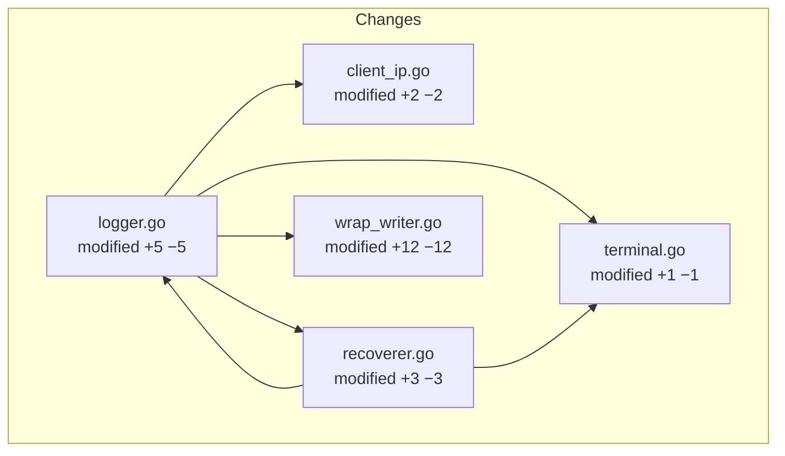
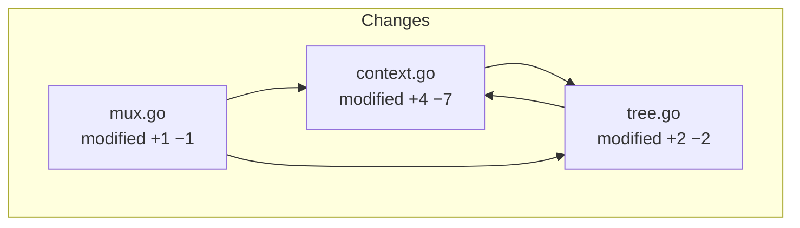

Change group 1 of 2 (disconnected in the selected scope):

Change group 2 of 2 (disconnected in the selected scope):

Also changed (no relationships in the selected scope):

- <code>.github/workflows/ci.yml</code> — modified (+1 / −1)
- <code>go.mod</code> — modified (+1 / −1)
- <code>middleware/basic_auth_test.go</code> — added (+59 / −0)
- <code>middleware/clean_path_test.go</code> — added (+23 / −0)
- <code>middleware/client_ip_bench_test.go</code> — modified (+2 / −2)
- <code>middleware/compress.go</code> — modified (+1 / −1)
- <code>middleware/heartbeat_test.go</code> — added (+31 / −0)
- <code>middleware/middleware_test.go</code> — modified (+60 / −1)
- <code>middleware/path_rewrite_test.go</code> — added (+26 / −0)
- <code>middleware/recoverer_test.go</code> — modified (+1 / −1)
- <code>middleware/terminal_test.go</code> — added (+36 / −0)
- <code>middleware/throttle_test.go</code> — modified (+1 / −2)
- <code>middleware/value.go</code> — modified (+1 / −1)
- <code>middleware/value_test.go</code> — added (+33 / −0)
- <code>middleware/wrap_writer_test.go</code> — modified (+88 / −15)
- <code>mux_test.go</code> — modified (+1 / −3)
- <code>tree_test.go</code> — modified (+1 / −3)
